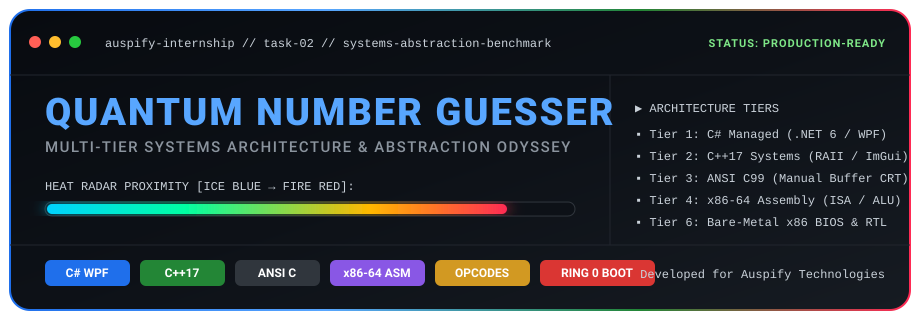

<div align="center">

  

  <br/><br/>

  <p align="center">
    <a href="https://github.com/Guptha0/Number-Guessing-Game"></a>
    
    <a href="LICENSE"></a>
  </p>

  <p align="center">
    
    
    
    
    
  </p>

  <p align="center">
    <strong>A high-performance benchmark tracing high-level OOP semantics down to bare-metal silicon execution.</strong><br/>
    <em>Engineered as Task 2 for the Auspify Technologies C/C++ Software Engineering Internship.</em>
  </p>

</div>

---

## 📑 Table of Contents

- [📌 Executive Summary](#-executive-summary)
- [🏛️ The Multi-Tier Architecture Matrix](#️-the-multi-tier-architecture-matrix)
- [🚀 Advanced Gameplay Mechanics](#-advanced-gameplay-mechanics)
  - [🌡️ Heat Radar (Proximity Metric)](#️-heat-radar-proximity-metric)
  - [⏱️ Triple Game Modes](#️-triple-game-modes)
  - [💥 Trauma-Based Screen Shake](#-trauma-based-screen-shake)
  - [🎨 Modern Cyberpunk UI/UX](#-modern-cyberpunk-uiux)
- [📂 Project Structure](#-project-structure)
- [🛠️ Quickstart: How to Run Each Tier](#️-quickstart-how-to-run-each-tier)
  - [Tier 1: C# Cyberpunk GUI (Windows WPF)](#tier-1-c-cyberpunk-gui-windows-wpf)
  - [Tier 2: C++ Systems Layer (WSL / Native)](#tier-2-c-systems-layer-wsl--native)
  - [Tier 3: Procedural ANSI C](#tier-3-procedural-ansi-c)
  - [Tier 4: x86-64 Assembly](#tier-4-x86-64-assembly)
  - [Tier 5: Machine Opcode Disassembly](#tier-5-machine-opcode-disassembly)
  - [Tier 6: Bare-Metal BIOS Bootloader OS](#tier-6-bare-metal-bios-bootloader-os)
- [💡 Low-Level Systems Insights](#-low-level-systems-insights)
- [🏆 Internship Credits & Acknowledgements](#-internship-credits--acknowledgements)
- [👨‍💻 Author](#-author)

---

## 📌 Executive Summary

Most introductory programming projects treat the Number Guessing Game as a trivial single-file while loop. **Quantum Number Guesser** completely reimagines this classic challenge into a comprehensive **6-tier systems architecture showcase**.

The repository systematically explores how program state, memory lifecycles, and branching mechanisms evolve across six computational layers:
1. **Managed Runtime & Virtual Machine Stack:** C# .NET 6 with garbage-collected generational heaps and RyuJIT compilation.
2. **Deterministic Systems RAII:** Modern C++17 leveraging `<random>` non-deterministic entropy and robust stream state-machine recovery (`std::cin.fail()`).
3. **Procedural Memory Management:** ANSI C99 with manual activation frames and explicit standard input buffer flushing.
4. **Instruction Set Architecture (ISA):** x86-64 NASM/GAS assembly with direct register allocations (`EAX`, `EBX`) and non-destructive ALU subtraction (`cmp`) driving status flag branching (`ZF`, `SF`, `OF`).
5. **Microarchitectural Decoding:** Hexadecimal opcode analysis (`39 D8`, `74 24`) tracing instruction fetch, decode, and ALU latching.
6. **Bare-Metal & Silicon RTL:** A 512-byte standalone BIOS bootloader operating at RAM `0x7C00` with zero host OS, alongside a synthesizable Verilog-2001 hardware circuit.

---

## 🏛️ The Multi-Tier Architecture Matrix

| Abstraction Tier | Target Platform | State & Memory Model | I/O Subsystem | Branching & Logic Engine |
| :--- | :--- | :--- | :--- | :--- |
| **Tier 1: C# (WPF & Console)** | .NET 6 CoreCLR Runtime | Managed Heap / Generational GC | Direct3D hardware-composited XAML | CIL Bytecode (`bgt.s`, `blt.s`, `beq.s`) |
| **Tier 2: C++ (Systems & ImGui)** | Native Compiled Executable | Stack / RAII Scope Lifetimes | `std::iostream` stream state recovery | Native compiler branch prediction |
| **Tier 3: C (Procedural CRT)** | Minimal C-Runtime (CRT) | Contiguous activation records | `printf` / `scanf` manual buffer draining | Direct machine conditional jumps |
| **Tier 4: Assembly (x86-64)** | System V AMD64 Hardware ISA | CPU Registers (`EAX`, `EBX`, `R12D`) | Direct ABI function calls (`@PLT`) | `cmp` ALU subtraction + `je`/`jl`/`jg` |
| **Tier 5: Machine Opcodes** | CPU Core Microarchitecture | Hardware SRAM Register File | L1 Instruction Cache / Bus Interconnect | Hex Opcodes (`39 D8`, `74 24`) |
| **Tier 6A: Bare-Metal Bootloader** | x86 Real-Mode BIOS (Ring 0) | Physical RAM at `0x7C00` | BIOS interrupts (`INT 0x10` / `0x16`) | Zero OS; direct hardware `IP` jumps |
| **Tier 6B: Digital Silicon RTL** | FPGA / ASIC Hardware Gates | Clocked D-Flip-Flop Registers | Physical DIP switches & LEDs | Hardware Finite State Machine (FSM) |

---

## 🚀 Advanced Gameplay Mechanics

### 🌡️ Heat Radar (Proximity Metric)
Rather than simple binary hints, the Heat Radar dynamically calculates a normalized mathematical proximity scalar $P \in [0.0, 1.0]$:

$$P = 1.0 - \min\left(1.0, \frac{|G - T|}{\max(T - \text{min}, \text{max} - T)}\right)$$

- `[0.00 - 0.25]` 🧊 **Ice Blue** (`#00D2FF`) — Distant guess.
- `[0.26 - 0.50]` 🌱 **Neon Mint** (`#00FFA3`) — Closing in.
- `[0.51 - 0.75]` ⚡ **Solar Amber** (`#FFB800`) — Warm!
- `[0.76 - 0.99]` 🔥 **Supernova Red** (`#FF2A54`) — Scorching hot!
- `[    1.00   ]` ✨ **Radiant Gold** (`#FFFFFF`) — Exact target matched!

### ⏱️ Triple Game Modes
- 🎯 **Classic:** Standard calibration with 7 attempts in the range $[1 - 100]$.
- ⚡ **Time Attack:** Real-time 30-second hardware countdown. Think fast before time runs out!
- 🧬 **Endurance:** Adaptive difficulty scaling. Every consecutive win expands the target search space exponentially:
  $$\text{Range}_{n+1} = \left[1, \; 100 \times 1.5^n\right]$$

### 💥 Trauma-Based Screen Shake
Incorporates the game development industry standard **Trauma-Based Quadratic Decay Model**:

$$\text{Displacement}(x, y) = \left( A \cdot \text{Trauma}^2 \cdot \sin(\omega_1 t), \; A \cdot \text{Trauma}^2 \cdot \cos(\omega_2 t) \right)$$

$$\text{Trauma} \leftarrow \max(0.0, \; \text{Trauma} - \lambda \cdot \Delta t)$$

Incorrect deductions introduce rotational and translational viewport trauma that decays smoothly over time.

### 🎨 Modern Cyberpunk UI/UX
- **Glassmorphism:** Dark-theme cards (`#161B22`), subtle borders (`#30363D`), and real-time linear gradient progress bars.
- **Particle Storm:** Procedurally animates 60+ celebratory physics-based confetti rectangles upon winning.

---

## 📂 Project Structure

```
📦 Number-Guessing-Game
├── 📂 assets              # Media assets & high-resolution SVG banners
│   └── 🎨 banner.svg      # Native GitHub-compatible vector banner
├── 📂 1_csharp            # Tier 1: C# OOP Console Application (.NET 6)
│   ├── 📄 GameManager.cs  # Encapsulated state machine & scoring logic
│   └── 📄 Program.cs      # CLI runner with int.TryParse input safety
├── 📂 2_cpp               # Tier 2: Modern C++ Systems Application
│   └── 📄 main.cpp        # std::mt19937 PRNG & std::cin.fail() stream safety
├── 📂 3_c                 # Tier 3: Procedural ANSI C Implementation
│   └── 📄 main.c          # Manual stdin buffer flushing & CRT rand()
├── 📂 4_asm               # Tier 4: x86-64 Assembly Architecture
│   ├── 📄 game.asm        # NASM syntax with libc linkage
│   └── 📄 game_gas.s      # GNU as / GCC Intel syntax
├── 📂 5_machine           # Tier 5: Machine-Level Opcode Disassembly
│   └── 📄 machine_code_breakdown.md # Bytecode encoding & ALU flags analysis
├── 📂 6_baremetal         # Tier 6A: 512-byte BIOS Bootloader OS (Ring 0)
│   └── 📄 boot.asm        # Pure 16-bit real-mode OS (No Windows / Linux needed)
├── 📂 6_verilog           # Tier 6B: Hardware Synthesizable Circuit
│   └── 📄 guessing_game.v # 8-bit LFSR PRNG, digital comparator & 7-seg decoder
├── 📂 gui_csharp          # Tier 1 GUI: Modern Cyberpunk WPF Desktop Application
│   ├── 📄 MainWindow.xaml # Hardware-composited glassmorphism layout
│   ├── 📄 MainWindow.xaml.cs # Proximity math, confetti & trauma engine
│   └── 📄 QuantumGuesser.csproj # .NET 6 WPF project file
├── 📂 gui_cpp             # Tier 2 GUI: High-Performance Dear ImGui Architecture
│   └── 📄 imgui_game.cpp  # 144 FPS Immediate-Mode loop & hardware timers
├── 📂 gui_c_raylib        # Tier 3 GUI: Retro Arcade Pixel Engine
│   └── 📄 arcade_game.c   # 8 KB pre-allocated contiguous particle arena
├── 📄 LICENSE             # MIT Open-Source License
└── 📄 README.md           # Engineering documentation
```

---

## 🛠️ Quickstart: How to Run Each Tier

### Tier 1: C# Cyberpunk GUI (Windows WPF)
Run from **Windows PowerShell**:
```powershell
cd "gui_csharp"
dotnet run
```
*Or directly double-click: `gui_csharp\bin\Debug\net6.0-windows\QuantumGuesser.exe`.*

---

### Tier 2: C++ Systems Layer (WSL / Native)
Run inside **WSL** or Linux terminal:
```bash
cd "2_cpp"
g++ -std=c++17 -O2 main.cpp -o guessing_cpp
./guessing_cpp
```

---

### Tier 3: Procedural ANSI C
```bash
cd "3_c"
gcc -Wall -Wextra -O2 main.c -o guessing_c
./guessing_c
```

---

### Tier 4: x86-64 Assembly
```bash
cd "4_asm"
# Compiles directly using GCC's integrated assembler:
gcc -no-pie game_gas.s -o guessing_asm
./guessing_asm

# Or assemble via NASM:
nasm -f elf64 game.asm -o game.o && gcc -no-pie game.o -o guessing_asm
```

---

### Tier 5: Machine Opcode Disassembly
Disassemble the compiled assembly binary to view the CPU's exact hex opcodes:
```bash
cd "4_asm"
objdump -d -M intel guessing_asm | grep -A 15 "<main>:"
```
**Sample Output:**
```text
  40114c:   bb 2a 00 00 00          mov    ebx, 0x2a      <-- Load target (42) into EBX
  401151:   45 31 e4                xor    r12d, r12d     <-- Reset attempts counter
  401154:   41 bd 07 00 00 00       mov    r13d, 0x7      <-- Max attempts = 7
  40116e:   39 d8                   cmp    eax, ebx       <-- ALU subtraction (39 D8)
  401170:   74 38                   je     4011aa         <-- Jump if ZF=1 (74 38)
```

---

### Tier 6: Bare-Metal BIOS Bootloader OS
Boot the game as an operating system in a virtual x86 CPU:
```bash
# Install NASM & QEMU in WSL:
sudo apt update && sudo apt install -y nasm qemu-system-x86

# Assemble the 512-byte raw Master Boot Record:
cd "6_baremetal"
nasm -f bin boot.asm -o boot.bin

# Boot directly to bare-metal silicon:
qemu-system-x86_64 -drive format=raw,file=boot.bin
```

---

## 💡 Low-Level Systems Insights

> [!NOTE]
> **Stream State Corruption vs. Memory Safety:**  
> In C++, if a user submits alphabetical characters when an integer is expected, `std::cin` sets `ios_base::failbit`, halting all subsequent extraction operations. The recovery idiom requires `std::cin.clear()` and `std::cin.ignore()`. In C, `scanf("%d")` leaves unread bytes in the CRT buffer, requiring a manual `while((c=getchar()) != '\n' && c != EOF)` drain loop. In C#, `int.TryParse` eliminates stream poisoning through managed string parsing.

> [!TIP]
> **Register Allocation & ALU Condition Codes:**  
> In Tier 4, the target is pinned in register `EBX`, the guess in `EAX`, and attempts in `R12D`. Executing `cmp eax, ebx` triggers an internal subtraction `(EAX - EBX)` that updates the `EFLAGS` register:
> - **ZF (Zero Flag):** Set to 1 if `EAX == EBX` (Match found).
> - **SF (Sign Flag) & OF (Overflow Flag):** `SF != OF` signals signed less-than (`jl`), while `ZF == 0 && SF == OF` signals signed greater-than (`jg`).

---

## 🏆 Internship Credits & Acknowledgements

This multi-tier engineering project was developed as **Task 2 of the Auspify Technologies C/C++ Software Engineering Internship**.

Special thanks to the engineering mentors at **Auspify Technologies** for designing a challenging curriculum that fosters low-level computing mastery, systems thinking, and end-to-end architectural engineering.

---

## 👨‍💻 Author

**C V Prajwal Guptha**  
*Systems Architect, Multi-Language Engineer & Intern @ Auspify Technologies*

- 🌐 **GitHub:** [@Guptha0](https://github.com/Guptha0)
- 💼 **Focus Areas:** Systems Programming (C/C++), Assembly (x86-64), Architecture & Performance Engineering

<div align="center">
  <sub>⭐ Found this architectural breakdown helpful? Star the repository on GitHub! ⭐</sub>
</div>
